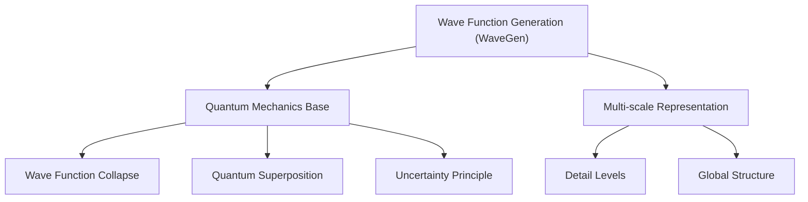

# The Comparison of WaveGen and Related Work

*“The edifice of Computer Vision has been completed, with only two black clouds remaining - ‘quadratic growth’ and ‘logical physical consistency’. Future generations will only need to increase data and computing power.” -- This is what the big companies say.*

## Overview

Here we provide a summary of WaveGen's advantages and experimental results to serve as a helpful summary.

Before all, in short, it is dedicated to achieving some new features that was not well accomplished by previous methods: like variable FPS, variable resolution, causality, physics, consistency, training the world itself, predicting the future/past, synchronizing the real world with model's core space, and pixel-level control of the world distribution, unlimited duration, native 3D+t, etc.

## 1. Basic Comparison

| Features | Wave Function Generation | Diffusion Model | GAN Model | Point Cloud | NeRFields | 3D Gaussian |
|----------|---------|-----------|-----|-------------|------|-------------|
| Generation Mechanism | Virtual-Real World Point Transformation | Noise Addition and Removal | Adversarial Generation | Geometric Modeling | Volume Rendering | Gaussian Distribution |
| Theory Foundation | Quantum Mechanics (Wave Collapse) | Thermodynamics (Entropy Inversion) | Game Theory | ✗ | ✗ | Statistical Mechanics |
| Iteration Steps | Single-step | Multi-step | Single-step | - | - | - |
| 2D Support | ✓ | ✓ | ✓ | ✗ | ✗ | ✗ |
| 3D Support | ✓ | ✗ | △Partial | ✓ | ✓ | ✓ |
| Representation | Implicit ↔ Explicit | the Explicit | the Explicit | the Explicit | is Implicit | the Explicit |

## 2. Core Advantages

### 2.1 Theoretical Foundation

These principles are only conceptually similar to each other, and it doesn't mean that we employ any sci-fi technologies.

### 2.2 Representation Capability

#### 2D
- **Compared to Diffusion Models**:
  - It is somewhat like a two-stage generative model, which makes it possible to have 3D-native features.
  - Too many new features and functions
  - After orthogonal separation of shape and rendering, the training becomes stable and easy

#### 3D
- **Compared to Point Clouds**:
  - Continuous field representation, no discretization issues
  - Natural support for multi-view consistency
  - Probabilistic generation avoids holes

- **Compared to NeRF**:
  - Faster rendering speed
  - Lower memory consumption
  - Support for dynamic scenes

- **Compared to 3D Gaussian**:
  - Unified physical framework
  - More functions and real-world attributes
  - A simpler shape representation, the mathematical wave is somewhat like an extremely large dynamic Gaussian kernel.

## 3. Technical Features

### 3.1 Unique Advantages

I have arranged the features of WaveGen from the most common to the least common. The previous models basically did not have these features. Considering some excellent works, they can generally reach a range of 4-5. Generally speaking, they even cannot manage to have 1-4 at the same time.

1: consistency; 2: native 3D+t; 3: variable resolution; 4: unlimited duration; 5:  predicting the future; 6: variable FPS; 7: physics; 8: causality; 9: predicting the past; 10: pixel-level control of the world distribution; 11: synchronizing the real world with model's core space; 12: training the world itself

```mermaid
gantt
    title Scale Range Comparison
    dateFormat X
    axisFormat %s
    
    section WaveGen
    Full scale range      :0, 12
    section Diffusion
    Limited scale range   :0, 5
    section GAN
    Limited scale range         :0, 5
    section AR
    Limited scale range         :0, 5
```

### 3.2 Computational Efficiency
| Model | Training Time | Inference Time | Memory Usage |
|-------|---------------|----------------|--------------|
| WaveGen | Medium | Fast | Medium |
| Diffusion | Slow | Slow | High |
| GAN | Fast | Fast | Low |
| Point Cloud | - | Fast | Low |
| NeRF | Slow | Slow | High |
| 3DGS | Medium | Fast | Medium |

## 4. Application Scenarios

| Application | WaveGen Model | Diffusion | GAN Model | Point Cloud | NeRF | 3DGS |
|-------------|---------|-----------|-----|-------------|------|------|
| Image/Conditional Generation | ✓ | ✓ | ✓ | ✗ | ✗ | ✗ |
| 3D Reconstruction | ✓ | △ | △ | ✓ | ✓ | ✓ |
| View Synthesis | ✓ | △ | △ | ✓ | ✓ | ✓ |
| 4D Reconstruction (Dynamic Scenes) | ✓ | △ | △ | △ | △ | △ |
| Real-time Rendering | ✓ | △ | ✓ | △ | ✗ | ✓ |
| understanding/estimation | ✓ | △ | ✗ | ✗ | ✗ | ✗ |

