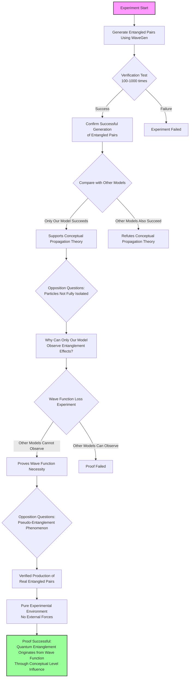

# Try to Explain Quantum Entanglement and "Spooky Action at a Distance"

While completing the World Snapshot project, I gained some insights, which I am releasing simultaneously at arXivxxxx.xxxx. It's not part of the WS project, just an interesting experimental attempt, so I wrote the related content separately in a new preprint.
<!--It is also part of a serious publication, which is prohibited from being republished or submitted to any form of publisher or address except by me. Its content can be discussed or advertised on the Internet, and my name (Sen Fang / 房森) must be mentioned.-->

Modern quantum mechanics has three fundamental problems that remain unsolved: 1. Why are measurement results random? 2. How is "spooky action at a distance, i.e. quantum entanglement" accomplished? 3. Is the wave function physical reality, or merely a mathematical tool?

In this section, I am temporarily only addressing the second question.

## Background

[Action at a distance](https://en.wikipedia.org/wiki/Action_at_a_distance) is the concept in physics that an object's motion can be affected by another object without the two being in physical contact. Quantum entanglement suggests that if a pair of entangled particles is generated such that their total spin is known to be zero, and one particle is found to have clockwise spin on the first axis, then the other particle (when measured on the same axis) will be found to have counterclockwise spin. For position, momentum, spin, etc, the situation is similar.

This phenomenon (is real, proved by [Bell's Theorem](https://www.quantamagazine.org/how-bells-theorem-proved-spooky-action-at-a-distance-is-real-20210720/) in 1964, the 2022 Nobel Prize was awarded for contributions to quantum entanglement information transmission science) is difficult to explain because: 1. Before measurement, each particle is in a superposition state and theoretically can take any allowed value. However, once one particle is measured, the other immediately "collapses" into a definite complementary value. This process appears to violate the principle of locality - it should be like flipping coins where, although the sum of probabilities of heads and tails is 1, there can be cases where both coins show heads. Rather than "one coin being heads meaning the other must be tails". 2. It easily exceeds the speed of light in its mutual influence. In 1905, Einstein's special relativity established a new view of space-time and indicated that the speed of light in vacuum is the limit for all physical interactions. This theory eliminated the possibility of instantaneous action at a distance in physics. 

## My Predictions and Inferences

Einstein believed that action at a distance was achieved through the influence of space-time. However, I propose a new perspective: <strong style="color: #666666">"quantum entanglement/'action at a distance' occurs at a speed of conceptual level. When I change variables in a wave function, the entire function affects the result. Therefore, I believe quantum entanglement operates at a speed of conceptual level."</strong> The entire universe may be like an ever-expanding WSF, with the WaveGen mechanism or concept covering every point in universe.

However, this occurrence isn't that fast. The "Schrödinger's cat" hypothesis suggests that macroscopic quantum superposition in biological systems is possible. But why doesn't it exist? It's because the number of particles is simply too large, causing mutual disturbance and susceptibility to external influences, making it easy for large quantum state organisms to collapse. Quantum states might only exist stably in the microscopic world.

I agree with this view. So I think: In the World Snapshot model, action at a distance occurs at a conceptual level (like changing the input variables of a wave function/WaveGen), and affects the speed of emergence depends on the rate of collapse, which is the speed at which world pixels transition from virtual to real. The real world should be the same.

I think the phenomenon of quantum entanglement/"Action at a distance" can be explained to some extent through World Snapshot. However, I still need some thinking to design a complete experiment. The steps we need to take are: 1. How to create entangled particles in WSF 2. Successfully reproduce the results of the real world 3. Explain non-local action through the results.

## Idea

I think we can use Backward Derivation:

First, we can test the entangled pairs generated by our WaveGen and verify that they are indeed entangled. We can test it a hundred or thousand times. When we find that the entangled particles only show opposite states, it proves that our entangled particles are successfully generated. (We can also consider rigorous methods to prove that this is an entangled pair: If we cannot rigorously prove this is an entangled pair, then we fall into circular reasoning. This is unacceptable.)

Then, we can consider two scenarios: 1. Different wave functions in the same spacetime: entangled particle pairs are in one image file, using wave function model A to collapse one particle, and then using wave function model B to collapse the other particle. 2. Same wave function in different spacetime: placing the entangled particles in two physically separated image files, they maintain their quantum states through WaveGen, and then collapse.

If we discover that: 1. Only our model and the produced entangled pairs can find entanglement phenomena, while others using another wave function collapse models cannot produce entanglement phenomena. 2. Under the same wave function, the entangled particle in different spacetime successfully collapsed correctly. This proves that quantum entanglement and "spooky action at a distance" are indeed propagated through conceptual means (they have to be within the coverage of the same wave function) rather than through spacetime.

If opponents think that the particles we produce are not completely isolated, we can ask them why only our WaveGen model can achieve quantum entanglement effects, while other WaveGen models cannot observe entanglement effects.

If this phenomenon occurs: once our model's wave function maintenance is lost, other WaveGen models cannot even observe it. Opponents might say this proves that the wave function grants this entanglement phenomenon. The wave function is necessary for the experiment to succeed, with no other possibilities - but this is exactly what we wanted to prove.

However, opponents might argue this is a pseudo-entanglement phenomenon that only exists when we maintain it. In reality, perhaps entanglement exists without wave function maintenance. This would suggest we haven't truly produced entangled pairs.

But we have previously verified that our wave function can produce entangled pairs. And our experiment has no external force influence. Even physical gravity cannot affect the images. So this verification path and experimental environment are very pure.

In this way, we have explained one of the three major puzzles of quantum mechanics. The other two may have also been explained in some sense.

Flowchart - Quantum Entanglement's Backward derivation

## Method

*Conceived this section on 19th Jan 25, Updated on 20th Jan 25*

<!--
The 2022 Nobel Prize in Physics was awarded to French physicist Alain Aspect, American theoretical and experimental physicist John F. Clauser, and Austrian physicist Anton Zeilinger for their contributions to quantum information science. Through experiments with entangled photons, they established that Bell's inequality does not hold in the quantum world, and pioneered the field of quantum information.

In general, these three scientists experimentally verified the violation of Bell's inequality, thus proving the completeness of quantum mechanics. They proved that quantum mechanics is complete and quantum entanglement exists. More directly, they demonstrated the potential for studying and controlling particles in entangled states. What happens to one particle in an entangled pair determines what happens to the other particle, even when they are too far apart to interact with each other. The laureates' development of experimental tools laid the foundation for a new era of quantum technology.
-->