# Q&As

This page records practical questions that do not belong in the paper: how the ecosystem accepts new models, how plugins remain independent, what should be shared after training, and which problems come next.

## How to Contribute?

Overall, it is like Minecraft or Terraria: forward-compatible and game-mod-style. We strive to make it easy for everyone to contribute, even without submitting a PR. Of course, we also fully welcome submissions.

How do we conceive of modular contributions:

1. It is structured with fixed interfaces, for example, the main model of WSM v1 is located in a certain folder in the repository, and all the other files are calls to it. This enables us to switch model architectures simply by changing the folder.
2. ControlWorld also calls files in a certain folder or folders under plugins. They have their own independent tabs. This means that all the plugins, all the model decoders, they should all be independent and isolated from each other. Installing plugins/models, uninstalling plugins/models should only involve adding or removing folders in specific locations.
3. For the backend of ControlWorld, we mainly place the newly added functions in this backend/python file under this plugin folder. If some basic functions are needed, we will call this backend located in the root directory. This way, we can ensure the modularization of the plugin. Unless you think certain functions are necessary and other plugins might also use them, after discussing with us, you can update them to this backend in the root directory.

The advantage of this approach is that everyone can edit and upgrade in their own repository. There is not always a need to submit a PR. As long as the work can be called by ControlWorld, a user can place its folder in the expected location or install it from a link, and then use the model or plugin.

This kind of thinking has learned some game development thinking such as that of Minecraft and Terraria mods. This enables everyone to easily make any improvements to our work, while we only provide a UI platform for maintenance. It is very important to give any developer sufficient permissions without affecting the core game itself.

Each repository has a Contributing.md file that automatically appears on its code page:

- [Contribute to WSMs](https://github.com/World-Snapshot/WSMs?tab=contributing-ov-file)
- [Contribute to ControlWorld](https://github.com/World-Snapshot/ControlWorld?tab=contributing-ov-file)

We welcome contributions in all forms:

- Prefer adding a compatible function or plugin over changing unrelated core behavior.
- Discuss ordinary bugs and proposals through GitHub Issues or PRs so that the decision remains public.
- A new model can be contributed as an independent folder at the WSMs repository root, for example <code>WSM_v1_new_model</code>. Give it its own name, environment, documentation, and entry point. If it is useful, we can present it in the main README without forcing it into Augustus.
- A ControlWorld plugin may keep its WebUI files inside the model folder. Installing or uninstalling it changes registration and visibility; it should not destroy the local plugin files.
- We try to reply within 36 hours when we see a contribution.

## Current Roadmap

### Phase I: Consolidate Augustus

- Repair weak or low-evidence Heads without disturbing successful tasks.
- Finish categorical deployment so that region generation and category assignment behave as one task.
- Strengthen sparse outputs, especially structured human representations, boxes, audio-conditioned selection, and other non-field targets.
- Keep data construction, official WSG Reader visualization, recommended checkpoints, inference, WebUI, and evaluation under the same modality contract.

### Phase II: Expand the Task Bank

- Add aligned modalities. One useful modality should create a family of estimation, generation, control, reconstruction, and cross-variable tasks.
- Preserve the correct representation for each target: dense fields remain dense, while sparse structures keep their own adapters.
- Train task tunnels independently and in parallel, then expose them through one graph and one ControlWorld interface.
- Use evaluation results to update the official model registry rather than rediscovering a checkpoint on every run.

### Phase III: Compose Visual Routes

- Connect trained tasks into Chains of Visual Thought whose intermediate World Snapshots are visible and editable.
- Study automatic routing, route verification, uncertainty, and recovery when an intermediate target is unreliable.
- Use complementary evidence to strengthen weak mappings, as RGB-assisted inverse rendering already demonstrates.

### Phase IV: Time, Physics, and Interactive Worlds

- Extend aligned snapshots into World Snapshot Video and longer temporal routes.
- Learn identity, geometry, motion, material, and physical variables together instead of asking RGB alone to hide all causality.
- Explore the principle of least action, meaningful initialization, and explicit physical constraints as research directions rather than claims already completed by WSM v1.

The literal analytic wave core is no longer the current implementation. Its deeper questions remain: what representation makes time, causality, physical constraints, and editable intermediate reasoning easier to learn?

<strong>Archived August 2025 WaveGen, Core Space, and Wave2Pixel roadmap</strong>

## Historical Future Work / Full RoadMap

```mermaid
gantt
   title Core Space progress
   dateFormat X
   axisFormat %s

   section Gen Capacity
   Static Single Object    :done, 0, 1
   Static Multi-Object     :done, 0, 2
   Dynamic Multi-Object (now)   :crit, active, 0, 3
   Dynamic Small Scene     :0, 4
   Dynamic Large Scene     :0, 5

```

```mermaid
gantt
   title Wave2Pixel progress
   dateFormat X
   axisFormat %s

   section Inference Speed
   12fps             :done, 0, 1
   24fps (now)           :crit, active, 0, 2
   60fps             :0, 3
   90fps             :0, 4
   120fps            :0, 5

   section Generalization
   100+ tasks/functions           :done, 0, 1
   200+ tasks/functions (now)          :crit, active, 0, 2
   500+ tasks/functions           :0, 3
   1000+ tasks/functions          :0, 4
   1500+ tasks/functions         :0, 5
```

Here, we take stock of the things that can be done in the future (Written on 16 August 2025, when the project is not yet mature enough to public).

Currently, Core Space obtain the world representation of waves from the real world (Normalized depth map; or point cloud), (i.e., some kind of dynamic function or probability space wave). Due to the limitations of GPUs, Wave2Pixel decoder should only be able to demonstrate potential and are far from being mature. However, the Wave2Pixel decoder part, with the help of the mature ecosystem of RF, should be relatively better.

<!--
I'm not saying that the wave generation model and the world snapshot are different parts. They are essentially the same thing. They need to be utilized together and form a whole. The wave generation model requires a wsg decoder. The world snapshot model also needs a core space. What I just mentioned was their bias. The world snapshot model is a model trained using the wave generation method. Although they are responsible for two orthogonal tasks, they still need to rely on each other. Perhaps only in a few cases do they need to be separate1.
-->

Therefore, next, we should:

### Phase One:

- **Create sufficient function probability wave datasets:** 1. For example, develop and use the SQ-SLAM method to convert the entire world into a wave function. 2. Perhaps the entire SMPL/MeshObj/Avatar ecosystems can be transferred over. 3. Integrate the SAM-Grounded tool with the existing wsg tools to obtain a better wsg dataset.

- **Improving and upgrading the wave2pixel:** I'm not sure if the model released for the first time can achieve a unified level of over 1500 visual tasks, but it is undoubtedly necessary to continue making improvements.

- **We can explore more generation methods to create the core space:** 1. perhaps 4D CNN is a better foundation for the world model and a way to construct the core space; 2. perhaps RNN like RWKV, Mamba, which are naturally suitable for maintaining states and align with our explicit world state concept; 3. perhaps the super-large Gaussian volume can replace the wave space; 4. perhaps the traditional several image generation methods (e.g., 3D VAE to TSDF to Mesh) can be changed into a two-stage method to create the core space; 5. DiC (Conv With Diffusion)/TCN? ...

- **Continue to increase the duration of the wave space:** By August 2025, it is impossible to achieve this in one step. We have to lower our goals. Perhaps the extremely long generation time or certain target concepts cannot be verified. We need to continuously prove the feasibility of the concepts.

### Phase Two:

- **Using sufficient data and GPU to train a complete model:** The new WSMs should be able to more comprehensively process the entire world, run a world more perfectly, quickly generate, understand, recognize, and reconstruct for visual and other tasks. And the version released in first should only be a proof-of-concept version. Perhaps we could consider extracting the knowledge from DINOv3: I believe the implicit representations still need to be transformed into explicit representations within our core space, and into interpretable attributes of the pixels in our world.

- **Strengthen the joint training of the core space and the decoder:** 1. I hope that there are light sources in the wave space, and these light sources can affect every part of the space and be reflected in the output, thereby assisting the decoder's rendering; 2. The joint training of physical information requires the cooperation of the information provided by the decoder's reverse reasoning. To maintain the simplicity of training the core space solely through depth maps, I am unwilling to input additional supervisory information because for the operation of the world, a lot of information is redundant. Of course, perhaps this can help provide the performance of world evolution. These knowledge should be objective knowledge such as density and softness, allowing the core space to learn -- how the shapes and interaction methods of objects with different properties change due to this objective knowledge (More specifically, **by reversing the "information encoded at the boundary" and feeding it back to the core space, this will be a new training method for WSM**). 3. To put it more simply, this is the reverse application of Sen Fang's initialization. It distills knowledge from the decoder to guide the generation of the core space, because the decoder supports "estimating everything": if the initialized domain is in the middle, it is actually useful for both the left and right sides at the same time. Above is the initialization of [Level 2](https://github.com/World-Snapshot/Sen-Fang-Initialization).

### Phase Three:

- **Try to construct the training of physical knowledge using unsupervised methods:** As of August 2025, there is no good method for unsupervised training of perfect physical operation rules. We can import the core space into Blender (we support such operations) for constraints, or we can calculate through the following physical quantities (even some work has attempted this). Although the merging, disappearance, and birth of waves should be able to solve some extreme scenarios, I hope there are simpler training methods: In a certain physical condition, all symmetries correspond to an invariant, that is, the conservation of conformal charges. This may help the model more strictly satisfy the common symmetry, which may be helpful for the model to comply with the minimum action. Perhaps when the decoder training is good enough, it can feed back to the operation of the core space.

- **An Adversarial Wave Generative Model that reduces reliance on WSG:** When we use the reverse reasoning (recognition and understanding) of our decoder, it can serve as a supervisory signal, as was mentioned in the previous level. However, perhaps it can also form a situation similar to adversarial learning, introducing adversarial learning into the wave generative model to achieve a mutual training situation. The key point is that WaveGen is both a generator and a discriminator. This is a concept. But if it is realized, it will be like sugar water mixing into clear water and blending together. World information will enter WaveGen. Training the world itself might have a faster method, just like for humans. However, this is merely a conjecture derived from the inspiration of osmotic pressure.

### Phase N:

- Of course, at the beginning of this project, we had a [brief reflection](https://world-snapshot.github.io/doc/index.html?page=S5_blogs/02_cv_rebirth.md).

## How to Cooperate?

For academic collaboration and technical discussion, contact the first author by [email](mailto:sen.fang@rutgers.edu), [X](https://x.com/SenFang01), or [Threads](https://www.threads.com/@senfang01). Ordinary bugs, feature requests, and code changes should use the relevant repository's Issue or PR tracker so that authors and the community can solve them together.

For deeper research, business, funding, or long-term development proposals, send the plan and general details to [DM](mailto:dnm@cs.rutgers.edu) and copy the first author.