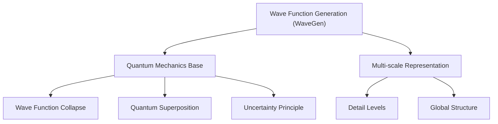

# Learn Quantum Wave Function Generation (WaveGen)

*"Whether God plays dice is unknown for me, but our world snapshot does play dice."*

## Overview

World Snapshot aims to unify digital reality at the pixel level, and WaveGen is its sharpest weapon. We defined and discussed the forms of WSG, WSV, and WSF in sequence, but I never said we would train these three formats separately.

In theory, WaveGen can directly train a continuous world field (WSF). When we fix the angle, it becomes WSV, and when we take a specific frame from it, we get WSG image generation.
Therefore, we will try to directly generate a dynamic world scene, which wave collapses according to viewing angles and frame numbers, and then export the format we want.

## Prospect

At the WSG level, I hope we can generate a perfect photo of a world scene. At the WSV level, we can generate an entire movie at once, or even generate continuous video spanning several days. At the WSF level, we hope to create a naturally coherent world where every user is a creator god.

I hope AI can generate a happy world without fatigue, without regret, only happiness and dreams coming true. When users enter it, they can even live a happy life forever. I mean: <strong style="color: #666666">Hope humans will have the ability to create the subordinate universe from now.</strong>

## 1. Basic Comparison

| Features | Wave Function Generation | Diffusion Model | GAN Model | Point Cloud | NeRFields | 3D Gaussian |
|----------|---------|-----------|-----|-------------|------|-------------|
| Generation Mechanism | Virtual-Real World Point Transformation | Noise Addition and Removal | Adversarial Generation | Geometric Modeling | Volume Rendering | Gaussian Distribution |
| Theory Foundation | Quantum Mechanics (Wave Collapse) | Thermodynamics (Entropy Inversion) | Game Theory | ✗ | ✗ | Statistical Mechanics |
| Iteration Steps | Single-step | Multi-step | Single-step | - | - | - |
| 2D Support | ✓ | ✓ | ✓ | ✗ | ✗ | ✗ |
| 3D Support | ✓ | ✗ | △Partial | ✓ | ✓ | ✓ |
| Representation | Implicit ↔ Explicit | the Explicit | the Explicit | the Explicit | is Implicit | the Explicit |

## 2. Core Advantages

### 2.1 Theoretical Foundation



### 2.2 Representation Capability

#### 2D Generation
- **Compared to Diffusion Models**:
  - Single-step generation, higher efficiency
  - Quantum wave function provides richer feature representation
  - Supports continuous multi-scale generation

- **Compared to GAN**:
  - More stable training process
  - Physical constraints provide better generation quality
  - Natural support for conditional generation

#### 3D Generation
- **Compared to Point Clouds**:
  - Continuous field representation, no discretization issues
  - Natural support for multi-view consistency
  - Probabilistic generation avoids holes

- **Compared to NeRF**:
  - Faster rendering speed
  - Lower memory consumption
  - Support for dynamic scenes

- **Compared to 3D Gaussian**:
  - Unified physical framework
  - Better theoretical guarantees
  - Adaptive sampling

## 3. Technical Features

### 3.1 Multi-scale Capability

```mermaid
gantt
    title Scale Range Comparison
    dateFormat X
    axisFormat %s
    
    section WaveGen
    Full scale range      :0, 10
    section Diffusion
    Limited scale range   :0, 4
    section GAN
    Single scale         :0, 3
    section Point Cloud
    Discrete scale      :0, 2
    section NeRF
    Limited scale range  :0, 4
    section 3DGS
    Gaussian scale      :0, 3
```


### 3.2 Computational Efficiency
| Model | Training Time | Inference Time | Memory Usage |
|-------|---------------|----------------|--------------|
| WaveGen | Medium | Fast | Medium |
| Diffusion | Slow | Slow | High |
| GAN | Fast | Fast | Low |
| Point Cloud | - | Fast | Low |
| NeRF | Slow | Slow | High |
| 3DGS | Medium | Fast | Medium |

## 4. Unique Advantages

### 4.1 Physical Significance
1. **Quantum Wave Function Representation**
   - Supports probabilistic interpretation
   - Natural uncertainty modeling
   - Physics-guided constraints

2. **Multi-scale Characteristics**
   - Adaptive resolution
   - Continuous scale transformation
   - Global-local correlation

### 4.2 Implementation Advantages
1. **Unified Framework**
   ```
   WaveGen
   ├── 2D Generation
   │   ├── Single View
   │   └── Multiple Views
   └── 3D Generation
       ├── Scene Reconstruction
       ├── View Synthesis
       └── Dynamic Scenes
   ```

2. **Flexibility**
   - Support for conditional generation
   - Controllable generation process
   - Easy to extend

## 5. Application Scenarios

| Application | WaveGen | Diffusion | GAN | Point Cloud | NeRF | 3DGS |
|-------------|---------|-----------|-----|-------------|------|------|
| Image Generation | ✓ | ✓ | ✓ | ✗ | ✗ | ✗ |
| 3D Reconstruction | ✓ | ✗ | △ | ✓ | ✓ | ✓ |
| View Synthesis | ✓ | △ | △ | ✓ | ✓ | ✓ |
| Dynamic Scenes | ✓ | △ | △ | △ | △ | △ |
| Real-time Rendering | ✓ | ✗ | ✓ | ✓ | ✗ | ✓ |

## 6. Limitations and Challenges
- High theoretical complexity
- Requires deep understanding of quantum mechanics
- High requirements for parameter tuning
- Potential computational overhead
"""

# Implementation follows...
class WaveGen:
    pass